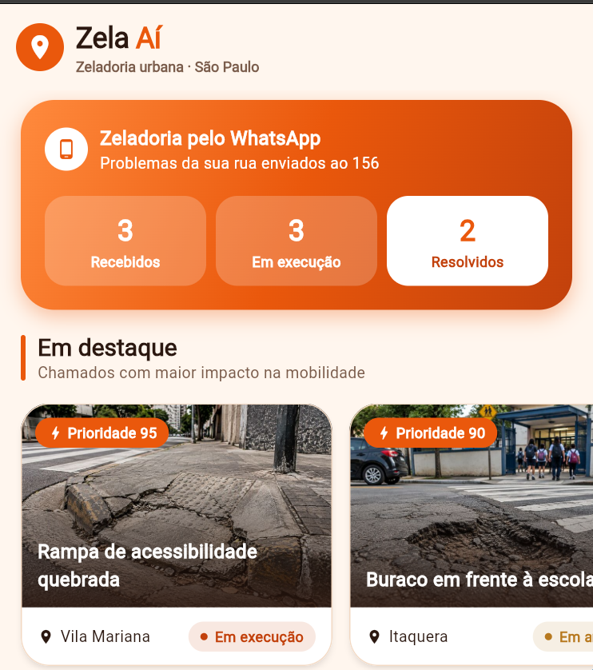
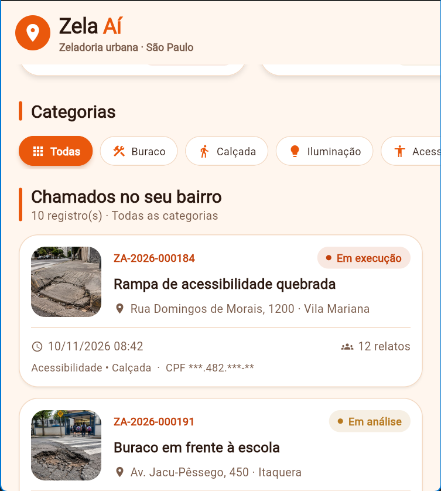
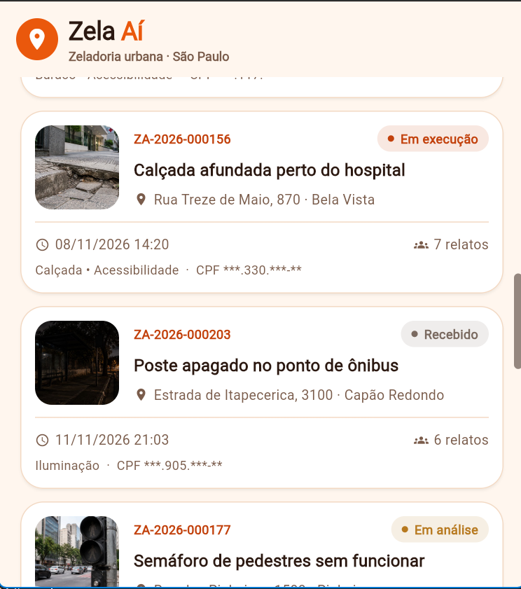

# Zela Aí — Global Solution 2026

Aplicativo mobile em **Flutter + Dart (Material 3)** para acompanhamento de chamados de zeladoria urbana da cidade de São Paulo.

## 👥 Desenvolvedores

| Nome completo | RM |
|---|---|
| Douglas Alexandre Ramos Hamasaki | 560565 |
| Felipe Yuji Mori | 559674 |
| Pedro Henrique Batista Ferrari | 559912 |

## 🌎 Tema da Global Solution

**CitizenTech** — tecnologia a serviço do cidadão. O Zela Aí aproxima a população da gestão da cidade: problemas da rua (buracos, calçadas quebradas, iluminação, acessibilidade, entulho, sinalização e árvores) são reportados pelo WhatsApp, com apoio de IA, e encaminhados ao portal 156 de São Paulo.

## 💡 Descrição da solução

O **Zela Aí** é um canal de zeladoria pelo WhatsApp integrado ao 156. Este aplicativo é o **painel de acompanhamento** dos chamados: mostra o que foi recebido, o que está em execução e o que já foi resolvido, priorizando os casos de maior impacto na mobilidade e na acessibilidade.

Por LGPD, o CPF do cidadão é exibido **mascarado**.

### Funcionalidades

- **Resumo** com a quantidade de chamados recebidos, em execução e resolvidos.
- **Destaques** (`ListView` horizontal): chamados com `destaque = true`, com foto, selo de prioridade, bairro e status.
- **Categorias** (`ListView` horizontal): 7 categorias + **Todas**; a categoria selecionada fica destacada em laranja.
- **Lista de chamados** (vertical): foto, protocolo, status, título, endereço, data, quantidade de relatos, categorias e CPF mascarado, ordenados por prioridade.
- **Filtro reativo** com `StatefulWidget` + `setState`.
- Mensagem amigável quando uma categoria não tem chamados.

## 🔀 Fluxo de telas

O app possui uma tela principal (`HomeScreen`) que concentra todo o fluxo:

```
Abertura do app
      │
      ▼
 HomeScreen
 ├── Resumo (recebidos / em execução / resolvidos)
 ├── Em destaque  ──► rolagem horizontal dos chamados prioritários
 ├── Categorias   ──► toque em uma categoria (ou "Todas")
 │                         │
 │                         ▼ setState
 └── Chamados no seu bairro ──► lista vertical atualizada pelo filtro
```

1. O usuário abre o app e vê o resumo, os destaques e a lista completa.
2. Ao tocar em uma categoria, o chip é destacado e a lista vertical é filtrada na hora, com o contador de registros atualizado.
3. Ao tocar em **Todas**, o filtro é removido.

## 📸 Prints das telas

| Tela inicial (resumo e destaques) | Categorias e lista de chamados | Lista de chamados (rolagem) |
|:---:|:---:|:---:|
|  |  |  |

## 🔌 API utilizada

**Nenhuma.** Os dados são mantidos em memória pela classe `ChamadoRepository`, conforme permitido no enunciado. O repositório foi isolado justamente para facilitar uma futura troca por uma API real (por exemplo, o portal 156) sem alterar as telas.

## 🏗️ Arquitetura

O projeto separa responsabilidades em camadas simples:

```
lib/
├── main.dart                  ponto de entrada e MaterialApp
├── models/                    dados e enumerações
│   ├── chamado.dart           classe Chamado (atributos tipados, construtor, bool destaque)
│   ├── categoria.dart         enum Categoria (um chamado tem uma ou mais)
│   └── status_chamado.dart    enum StatusChamado
├── repository/
│   └── chamado_repository.dart  centraliza os dados e as regras de consulta/filtro
├── screens/
│   └── home_screen.dart       StatefulWidget; guarda a categoria selecionada (setState)
├── components/                widgets reutilizáveis
│   ├── chamado_card.dart      item da lista principal
│   ├── categoria_chip.dart    chip e lista horizontal de categorias
│   ├── destaque_card.dart     item e lista horizontal de destaques
│   ├── resumo_card.dart       painel de indicadores
│   ├── status_badge.dart      selo de status
│   ├── info_linha.dart        linha ícone + texto
│   ├── secao_titulo.dart      título de seção
│   ├── foto_chamado.dart      imagem do chamado
│   └── categoria_visual.dart  ícones e cores associados aos enums
├── theme/                     app_colors e app_theme (identidade visual)
assets/images/                 fotos ilustrativas dos 10 chamados
test/widget_test.dart          testes de widget (seções e filtro)
```

**Como as peças se conectam**

- **Modelo:** cada chamado é um objeto `Chamado`; as categorias são um `enum`, então nenhuma regra de filtro usa strings.
- **Repositório:** `ChamadoRepository` expõe `getChamados()`, `getChamadosPorCategoria()`, `getDestaques()`, `getCategorias()` e `contarPorStatus()`. As telas nunca criam dados.
- **Estado:** `HomeScreen` guarda apenas `_categoriaSelecionada`. Ao tocar em um chip, `setState` reconstrói a tela e o repositório devolve a lista filtrada.
- **Componentes:** os itens da lista, as categorias e os destaques são widgets próprios, em arquivos separados e reutilizáveis.
